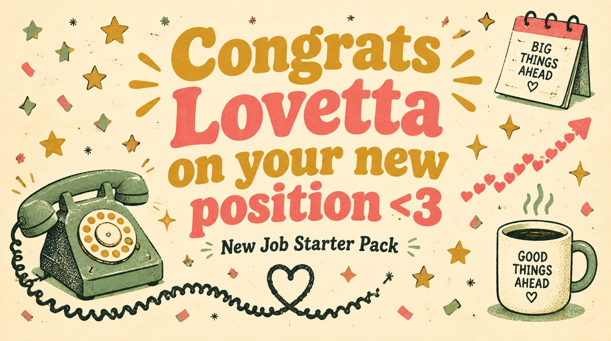
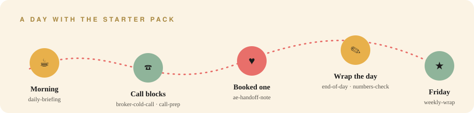

  

<h1 align="center">Lovetta's New Job Starter Pack</h1>

  
  
  
  

<i>You did the work, you nailed the room, and now the phone's yours. Here are 14 Claude skills to make the first 90 days a little easier. Go get 'em. — Taylor</i>

---

## What's in the box

### Made for you
These three were written from the prep we did together.

| Skill | What it does | Say this to Claude |
|---|---|---|
| ☎️ [`broker-cold-call`](skills/broker-cold-call/SKILL.md) | Builds the 5-beat opener and answers the three brush-offs. Can also role-play a busy broker with you. | *"role-play a broker with me"* |
| 💌 [`ae-handoff-note`](skills/ae-handoff-note/SKILL.md) | Checks a meeting is real, then writes the Slack note your AE actually wants. | *"handoff note for my call with…"* |
| 📈 [`numbers-check`](skills/numbers-check/SKILL.md) | Paste in your dials, conversations, booked and held meetings, and it finds where the funnel leaks and gives you one fix for tomorrow. | *"numbers check: 110 dials, 9 convos, 3 booked"* |

### Your daily rhythm
| | Skill | What it does |
|---|---|---|
| ☕ | [`daily-briefing`](skills/daily-briefing/SKILL.md) | Morning rundown of today's meetings, who's waiting on you, and what to hit first. |
| 🗂️ | [`call-prep`](skills/call-prep/SKILL.md) | A brief before a call or meeting: who's on it, the history, and what to ask. |
| 🛡️ | [`handle-objection`](skills/handle-objection/SKILL.md) | Works through an objection live: what they really mean and what to say back. |
| 📝 | [`call-summary`](skills/call-summary/SKILL.md) | Turns your call notes into a follow-up email, a team summary, and CRM updates. |
| ✅ | [`log-activity`](skills/log-activity/SKILL.md) | Logs a call or email to the CRM after the fact. |
| 🌙 | [`end-of-day`](skills/end-of-day/SKILL.md) | Closes out the day with every call processed and every commitment captured. |
| ⭐ | [`weekly-wrap`](skills/weekly-wrap/SKILL.md) | Friday readout of what moved, what didn't, and what's on deck for Monday. |

### Know the territory
| | Skill | What it does |
|---|---|---|
| 🔎 | [`account-research`](skills/account-research/SKILL.md) | Researches a firm and a producer: news, priorities, and fit. |
| 🕸️ | [`stakeholder-map`](skills/stakeholder-map/SKILL.md) | Maps an office: who's who, who's a champion, who you haven't met yet. |
| ✉️ | [`draft-outreach`](skills/draft-outreach/SKILL.md) | Drafts a personal email or a short multi-touch sequence that supports the call. |
| ♟️ | [`competitive-intelligence`](skills/competitive-intelligence/SKILL.md) | Your play when a broker already works with someone else. |

## Install (2 minutes)

1. Download this repo: click the green **Code** button, then **Download ZIP**, then unzip it.
2. Copy the folders inside `skills/` into `~/.claude/skills/`.
3. Open Claude Code and say a trigger line from the tables above. That's it.

> **Tip:** the CRM, email and calendar skills work best once you connect those tools to Claude. Without them, just paste in your notes and they still work.

## Rules of the road
- Never paste client names, member data, or anything confidential from work into a personal AI tool. Follow your company's AI policy first.
- These are starting points. Make the openers sound like you, not like a script.

---

The 11 sales skills come from Anthropic's <a href="https://github.com/anthropics/knowledge-work-plugins">knowledge-work-plugins</a> and are used under the <a href="skills/LICENSE-anthropic-knowledge-work-plugins">Apache 2.0 license</a>. The three "made for you" skills and the art were made by Taylor for Lovetta. ♡

